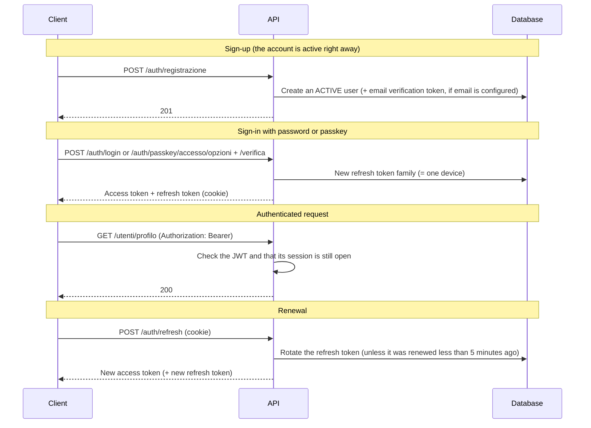

# Authentication

## Overview

Users sign in with email and password (hashed with **Argon2id**) or with a **passkey** (fingerprint, face or device PIN, via WebAuthn). Every sign-in opens a session: a 15-minute **JWT access token** and an opaque **refresh token** in an `httpOnly` cookie, rotated at every renewal. Each session is a "linked device" that users can see and sign out from the Profile page.

Code: `backend/src/services/autenticazione.service.js`, `passkey.service.js`, `utils/tentativiAccesso.js`, `middleware/autenticazione.js`; in the frontend `contesti/AuthContesto.jsx` and `config/api.js`.

## Flow

The Personal Trainer role is requested at sign-up or from the Profile page, and an administrator approves it.

## Endpoints (`/api/v1/auth`)

| Method | Path | Auth | Description |
|--------|------|------|-------------|
| POST | `/registrazione` | — | New user |
| POST | `/login` | — | Sign in with email and password |
| GET | `/verifica-email` | — | Confirm the email with the token from the link |
| POST | `/reinvia-verifica` | — | Send the verification email again |
| POST | `/richiedi-reset` | — | Email with a link to set a new password |
| POST | `/reimposta-password` | — | New password, with the token from the link |
| POST | `/refresh` | 🍪 | Renew the access token |
| POST | `/logout` | 🍪 | Close the session of this device |
| GET | `/sessioni` | 🔑 | Linked devices, the current one first |
| POST | `/sessioni/chiudi-altre` | 🔑 | Sign out all the other devices |
| DELETE | `/sessioni/:famiglia` | 🔑 | Sign out one device |
| POST | `/passkey/accesso/opzioni`, `/passkey/accesso/verifica` | — | Passkey sign-in: challenge, then signature |
| GET | `/passkey` | 🔑 | The user's passkeys |
| POST | `/passkey/registrazione/opzioni`, `/passkey/registrazione/verifica` | 🔑 | Add a passkey (asks for the password) |
| DELETE | `/passkey/:id` | 🔑 | Delete a passkey |

🍪 refresh token in the cookie · 🔑 access token.

## Security

- **Passwords**: Argon2id (64 MB of memory, 3 iterations, 4 threads).
- **Access token**: a 15-minute JWT with user, role and session. Closing a session stops its access tokens at once.
- **Refresh token**: opaque, 7 days (30 with "Remember this device"). The database keeps only its hash, like the email verification tokens (24 hours) and the password reset tokens (1 hour).
- **Rotation**: at every renewal the token is replaced by the next one, unless it was renewed less than 5 minutes ago. A device one rotation behind (lost response, two tabs at once, browser closed before saving the cookie) gets the replacement again. A token two rotations behind means someone else is using the session: all the user's sessions are closed.
- **Attempts**: 20 sign-in requests every 15 minutes per address. Per email, after 5 failures in a row, a one-minute lockout that doubles at every failure, up to 15 minutes. It applies to emails that do not exist too, so the lockout does not reveal who has an account.
- **Passkeys**: valid for the domain of `APP_URL` (if missing, `https://gymmaster.<DOMINIO>`).
- **Email**: verification and reset only work with `RESEND_API_KEY`. Without it, verification stays off and the administrator resets passwords by generating a temporary one.
- **Cookies**: `httpOnly`, `sameSite: strict`, `secure` when the request comes over HTTPS.
