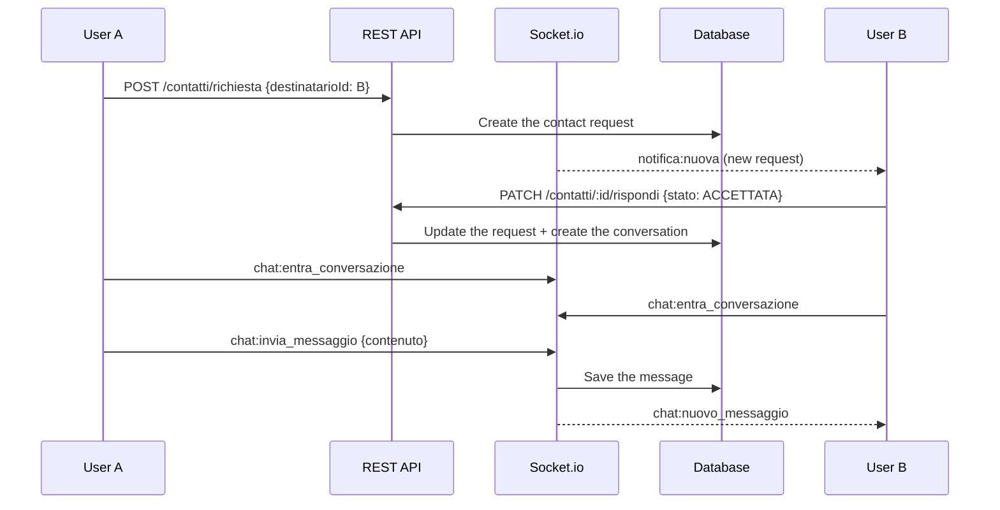

# Chat

## Overview

Real-time messaging over **Socket.io**, between members and with their personal trainer. Before two people can write to each other, one sends a contact request and the other accepts it.

Code: `backend/src/routes/chat.routes.js`, `controllers/chat.controller.js`, `socket/gestori/chat.gestore.js`; in the frontend `pagine/Chat.jsx`.

## Notifications on the chat page

The chat page has three tabs: Chat, Notifiche (notifications) and Richieste (requests). The tab is in the address (`/chat?tab=notifiche`), so going back from where a notification led returns to the list. On the phone this is the notification centre: the bell is only in the desktop sidebar.

- `contesti/NotificheContesto.jsx` is the one source for the bell, the Notifiche tab and the badge of the bottom bar. It keeps the latest 50 notifications (`GET /notifiche`), adds the ones arriving on `notifica:nuova`, and marks them read (`PATCH /notifiche/:id/letta`, `POST /notifiche/segna-tutte-lette`), so a notification read in one place is read everywhere.
- The badge on the chat tab of the bottom bar counts unread notifications plus unread messages (`GET /chat/non-letti`, read again at every page and when the app comes back: a message reaches the socket only while its conversation is open).
- A notification opens only a path inside the app (`utils/notifiche.js`, `percorsoInterno`).

## Privacy

- **Request first**: nobody can send a message until the recipient has accepted the contact request.
- **Blocking**: a request can be answered by blocking the sender (state `BLOCCATA`).
- **Retention**: the messages a user sends are kept for `chatRetentionGiorni` days (default 7, 0 = forever), then deleted for everyone in the conversation. Each user chooses it in Profile → Privacy: 7, 30 or 90 days, 1 year or forever (`utils/durataChat.js`); the server accepts whole days from 0 to 365.
- **Cleanup**: every 6 hours the server deletes the expired messages (`pulisciMessaggiScaduti` in `chat.service.js`).

## Flow

## REST endpoints (`/api/v1/chat`)

| Method | Path | Description |
|--------|------|-------------|
| POST | `/contatti/richiesta` | Send a contact request |
| PATCH | `/contatti/:id/rispondi` | Answer it (accept, reject or block) |
| GET | `/contatti/ricevute` | Pending requests |
| GET | `/conversazioni` | Conversations |
| GET | `/conversazioni/:id/messaggi` | Messages, paginated |
| GET | `/non-letti` | Number of unread messages |

## Socket.io events

| Event | Direction | Description |
|-------|-----------|-------------|
| `chat:entra_conversazione` | Client → Server | Join the room of a conversation |
| `chat:esci_conversazione` | Client → Server | Leave the room |
| `chat:invia_messaggio` | Client → Server | Send a message (with a callback) |
| `chat:nuovo_messaggio` | Server → Client | A new message arrived |
| `chat:sta_scrivendo` | Both ways | Typing indicator |
| `chat:smesso_scrivere` | Both ways | Stopped typing |
| `notifica:nuova` | Server → Client | In-app notification |

A new message also goes out as a push notification (if enabled; with the app open, the chat shows it instead) and, to recipients who are not connected, on Telegram (if linked).
