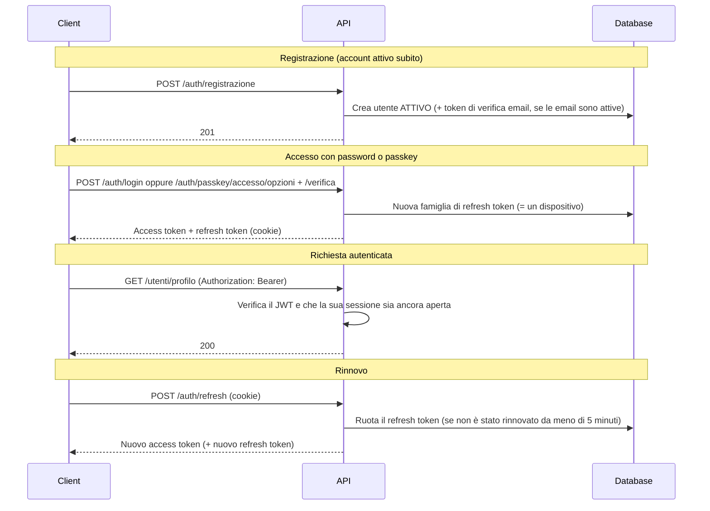

# GymMaster — Modulo Autenticazione

## Panoramica

Si entra con email e password (hash **Argon2id**) oppure con una **passkey** (impronta, volto o PIN del dispositivo, WebAuthn). Ogni accesso apre una sessione: un **access token JWT** di 15 minuti e un **refresh token** opaco in un cookie `httpOnly`, che ruota a ogni rinnovo. Ogni sessione è un "dispositivo collegato" che l'utente vede e può scollegare dal Profilo.

Codice: `backend/src/services/autenticazione.service.js`, `passkey.service.js`, `utils/tentativiAccesso.js`, `middleware/autenticazione.js`; nel frontend `contesti/AuthContesto.jsx` e `config/api.js`.

## Flusso

Il ruolo Personal Trainer si chiede in registrazione o dal Profilo e lo approva un amministratore.

## Endpoint (`/api/v1/auth`)

| Metodo | Percorso | Auth | Descrizione |
|--------|----------|------|-------------|
| POST | `/registrazione` | — | Nuovo utente |
| POST | `/login` | — | Accesso con email e password |
| GET | `/verifica-email` | — | Conferma l'email con il token del link |
| POST | `/reinvia-verifica` | — | Rimanda l'email di verifica |
| POST | `/richiedi-reset` | — | Email con il link per una password nuova |
| POST | `/reimposta-password` | — | Password nuova con il token del link |
| POST | `/refresh` | 🍪 | Rinnova l'access token |
| POST | `/logout` | 🍪 | Chiude la sessione di questo dispositivo |
| GET | `/sessioni` | 🔑 | Dispositivi collegati, quello corrente per primo |
| POST | `/sessioni/chiudi-altre` | 🔑 | Scollega tutti gli altri dispositivi |
| DELETE | `/sessioni/:famiglia` | 🔑 | Scollega un dispositivo |
| POST | `/passkey/accesso/opzioni`, `/passkey/accesso/verifica` | — | Accesso con passkey: sfida, poi firma |
| GET | `/passkey` | 🔑 | Le passkey dell'utente |
| POST | `/passkey/registrazione/opzioni`, `/passkey/registrazione/verifica` | 🔑 | Aggiunge una passkey (chiede la password) |
| DELETE | `/passkey/:id` | 🔑 | Elimina una passkey |

🍪 refresh token nel cookie · 🔑 access token.

## Sicurezza

- **Password**: Argon2id (64 MB di memoria, 3 iterazioni, 4 thread).
- **Access token**: JWT di 15 minuti con utente, ruolo e sessione. Una sessione chiusa ferma subito anche i suoi access token.
- **Refresh token**: opaco, 7 giorni (30 con "Ricorda questo dispositivo"). Nel database resta solo la sua impronta, come per i token di verifica email (24 ore) e di reset della password (1 ora).
- **Rotazione**: a ogni rinnovo il token è sostituito dal successivo, salvo se è stato rinnovato da meno di 5 minuti. Un dispositivo rimasto indietro di una rotazione (risposta persa, due schede insieme, browser chiuso prima di salvare il cookie) riceve di nuovo il sostituto. Un token indietro di due rotazioni vuol dire che la sessione la usa qualcun altro: si chiudono tutte le sessioni dell'utente.
- **Tentativi**: 20 richieste di accesso ogni 15 minuti per indirizzo. Per ogni email, dopo 5 errori di fila un blocco di un minuto che raddoppia a ogni errore, fino a 15 minuti. Vale anche per le email che non esistono, così il blocco non rivela chi è iscritto.
- **Passkey**: valgono per il dominio di `APP_URL` (in mancanza `https://gymmaster.<DOMINIO>`).
- **Email**: verifica e reset funzionano solo con `RESEND_API_KEY`. Senza, la verifica resta spenta e la password la reimposta l'amministratore, che genera una password temporanea.
- **Cookie**: `httpOnly`, `sameSite: strict`, `secure` quando la richiesta arriva in HTTPS.
